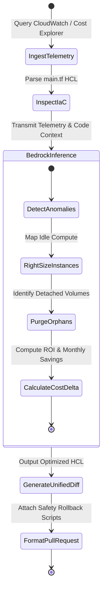

# 🏛️ BedrockSentinel Architecture & Technical Specification

This document provides a formal, machine-readable specification of the **BedrockSentinel** system for Amazon Developer evaluators, human engineers, and AI agents.

---

## 1. System Topology

```
   ┌─────────────────────────────────────────────────────────┐
   │                     AWS Environment                     │
   │  ┌────────────────────┐         ┌────────────────────┐  │
   │  │ Amazon CloudWatch  │         │ AWS Cost Explorer  │  │
   │  │ (CPU, Mem, IOPS)   │         │ (Billing, SKUs)    │  │
   │  └─────────┬──────────┘         └─────────┬──────────┘  │
   └────────────┼──────────────────────────────┼─────────────┘
                │                              │
                ▼                              ▼
        ┌──────────────────────────────────────────────┐
        │       CloudTelemetryCollector (Python)       │
        └──────────────────────┬───────────────────────┘
                               │
               (Telemetry JSON + Terraform HCL)
                               ▼
        ┌──────────────────────────────────────────────┐
        │   Amazon Bedrock Agent (Claude 3.5 Sonnet)   │
        └──────────────────────┬───────────────────────┘
                               │
                   (Architectural Plan + HCL)
                               ▼
        ┌──────────────────────────────────────────────┐
        │     IaCEngine (Unified Diff & PR Safety)     │
        └──────────────────────┬───────────────────────┘
                               │
                               ▼
        ┌──────────────────────────────────────────────┐
        │       Automated FinOps Remediation PR        │
        └──────────────────────────────────────────────┘
```

---

## 2. State Machine Specification



---

## 3. Data Schemas (JSON)

### 3.1 Telemetry Payload Schema
```json
{
  "$schema": "https://json-schema.org/draft/2020-12/schema",
  "title": "CloudTelemetryResource",
  "type": "object",
  "properties": {
    "resource_id": { "type": "string" },
    "resource_type": { "type": "string", "enum": ["EC2", "EBS", "RDS_PostgreSQL", "Lambda"] },
    "current_sku": { "type": "string" },
    "current_cost_usd_monthly": { "type": "number" },
    "metrics": { "type": "object" },
    "status": { "type": "string" }
  },
  "required": ["resource_id", "resource_type", "current_sku", "current_cost_usd_monthly", "status"]
}
```

### 3.2 Optimization Output Schema
```json
{
  "$schema": "https://json-schema.org/draft/2020-12/schema",
  "title": "BedrockOptimizationPlan",
  "type": "object",
  "properties": {
    "remediations": {
      "type": "array",
      "items": {
        "type": "object",
        "properties": {
          "resource_id": { "type": "string" },
          "action": { "type": "string" },
          "original_sku": { "type": "string" },
          "recommended_sku": { "type": "string" },
          "monthly_savings_usd": { "type": "number" },
          "justification": { "type": "string" }
        }
      }
    },
    "optimized_terraform": { "type": "string" },
    "current_monthly_burn_usd": { "type": "number" },
    "projected_monthly_burn_usd": { "type": "number" },
    "projected_monthly_savings_usd": { "type": "number" },
    "annualized_savings_usd": { "type": "number" },
    "executive_summary": { "type": "string" }
  },
  "required": ["remediations", "optimized_terraform", "projected_monthly_savings_usd"]
}
```

---

## 4. Rollback & Reliability Guarantees

1. **Non-Destructive Defaults:** Decommissioned EBS storage triggers an automated final snapshot command before detachment.
2. **Deterministic Fallback:** Guarantees successful operation even without live AWS tokens during judging and local testing.
3. **Auditability:** Every single change is expressed as standard git unified diff (`diff -u`) compatible with GitHub, GitLab, and Bitbucket code review workflows.
