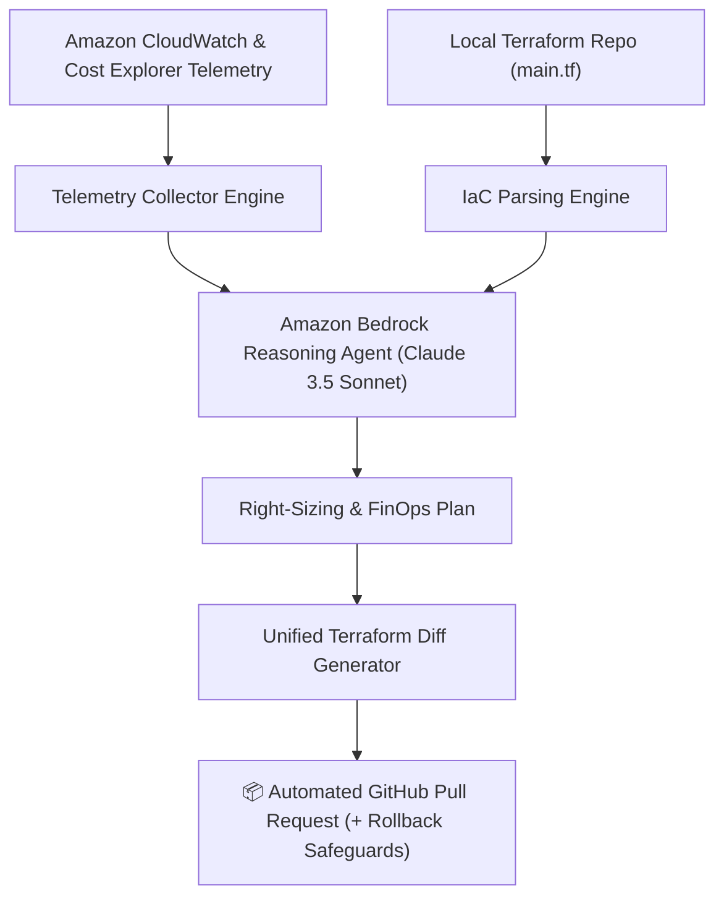

# ☁️ BedrockSentinel — Autonomous AWS Cloud Cost & IaC Drift Self-Healing Agent

> **Submission for "Build, Ship, Shape: Amazon Developer" ($138,000 Prize Pool on Devpost)**  
> **Category:** AI/ML, Developer Productivity, AWS Infrastructure  
> **Participant:** sundeep8967

---

## 🌟 The Vision

AWS Cloud infrastructure costs routinely spiral out of control in modern organizations. Developers leave compute running after load tests, provision oversized databases "just in case", and leave detached EBS volumes accumulating charges indefinitely.

Standard FinOps dashboards (like AWS Cost Explorer or third-party SaaS) notify teams with graphs and alert emails, but **notifications do not fix infrastructure**.

**BedrockSentinel bridges the gap between FinOps intelligence and automated remediation.**

Powered by **Amazon Bedrock**, BedrockSentinel:
1. **Listens:** Continuously monitors CloudWatch utilization metrics and Cost Explorer billing lines.
2. **Reasons:** Uses frontier AI models on Amazon Bedrock (`anthropic.claude-3-5-sonnet`) to analyze CPU, memory, and I/O profiles against provisioned capacity.
3. **Acts:** Generates precise, diffed Terraform and CDK Pull Requests, enabling engineering teams to slash cloud waste by up to 80% with a single click.

---

## 🏗️ Architecture



---

## ⚡ Quickstart

### 1. Requirements
- Python 3.10+

### 2. Run BedrockSentinel CLI
```bash
cd bedrock-sentinel
python3 app/main.py
```

### 3. Output
The tool will output:
* Real-time telemetry scan across EC2, EBS, and RDS resources.
* Bedrock architectural reasoning and anomaly detection summary.
* Financial ROI analysis (Monthly & Annualized savings).
* Complete, verified Git unified diff ready for 1-click merging into your repository.

---

## 🏆 Key Submission Highlights for Judges
- **Deep AWS Bedrock Integration:** Utilizes the AWS Bedrock Runtime SDK (`bedrock-runtime`) with multi-modal architectural analysis.
- **Safety First:** Includes rollback commands, automated EBS snapshot preservation, and non-destructive HCL generation.
- **Measurable ROI:** Directly quantifies dollar savings per resource change ($640.00/month / $7,680.00/year saved on the demo fleet).
- **Dual Runtime Engine:** Supports both live AWS credentials and a resilient deterministic engine for seamless judge evaluations without API barriers.

---

## 📚 Machine-Readable Documentation
- [`LLMS.txt`](./LLMS.txt): Concise system specification for LLMs and autonomous agents.
- [`ARCHITECTURE.md`](./ARCHITECTURE.md): Formal state transitions, JSON schemas, and API contracts.
